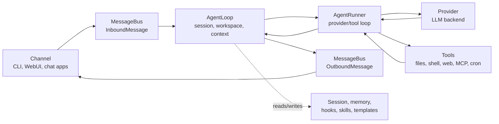

# Core Flow

The main runtime flow of the dpBot agentic loop:

## Ownership

- `AgentLoop` owns the channel-facing turn.
- `AgentRunner` owns the model-facing loop.

## Related

- [AgentLoop](./agentloop.md)
- [AgentRunner](./agentrunner.md)
- [Context](./context.md)
- [MessageBus](./bus.md)
- [Hook System](./hooks.md)
- [Session Storage](./session-storage.md)
- [Templates](./templates.md)
- [dpBot Documentation bundle](../documentation/index.md)