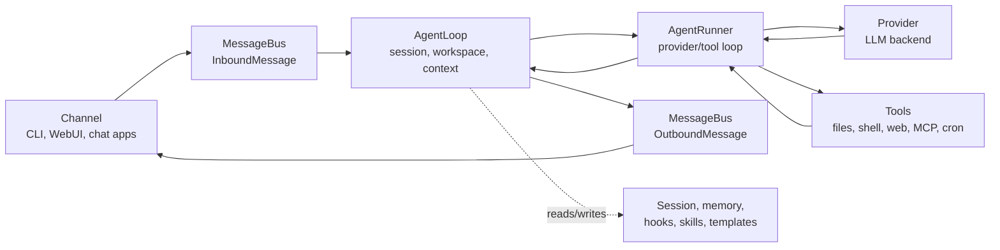

# Architecture Runtime Flow

The Python gateway owns agent execution, sessions, tools, memory, and
security policy for the WebUI, TUI, and chat apps. The clients share that
runtime; the core agent loop builds context, calls the model, executes
requested tools, and returns the result.

## Core Flow

## Agent Loop vs Agent Runner

- `AgentLoop` owns the channel-facing turn: receives inbound messages,
  determines the effective session and workspace scope, builds context,
  wires hooks, progress, and channel metadata, and publishes outbound
  messages.
- `AgentRunner` owns the model-facing loop: sends messages to the selected
  provider, handles streaming deltas and reasoning blocks, executes tool
  calls, feeds tool results back into the model, and stops when a final
  answer is produced or runtime limits are hit.

## Source Ownership

| Area | Files |
|---|---|
| Message events and queue | `nanobot/bus/events.py`, `nanobot/bus/queue.py` |
| Turn orchestration | `nanobot/agent/loop.py` |
| Provider/tool conversation loop | `nanobot/agent/runner.py` |
| Context construction | `nanobot/agent/context.py` |
| Session storage and compaction | `nanobot/session/manager.py` |
| Long-term memory and Dream | `nanobot/agent/memory.py` |

## Channels

Channels translate external platforms into `InboundMessage` events and
send `OutboundMessage` events back to the platform. Channels are
discovered by scanning self-contained packages under `nanobot/channels/`.

## WebUI and Gateway

`nanobot gateway` starts enabled chat channels, the WebSocket channel,
heartbeat, Dream, and long-running services. The WebUI launcher is the
normal browser entry point; underneath, the gateway keeps the WebSocket
channel and other long-running services alive.

## Related

- [Architecture Source Ownership](./architecture.md) — Source ownership and paths
- [Configuration](./configuration.md) — Config schema and defaults.
- [Security](./security.md) — Security boundaries and access control.
- [CLI Reference](./cli-agent.md) — Command-line interface.
- [WebUI](./webui-topics.md) — Browser workbench.
- [Concepts](../concepts.md) — User-facing runtime model.